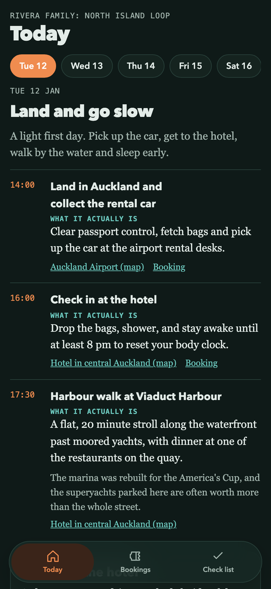
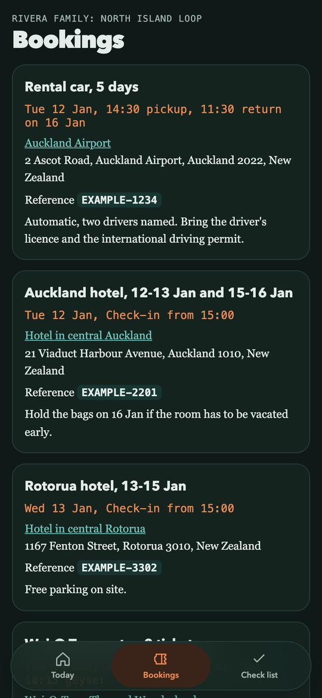
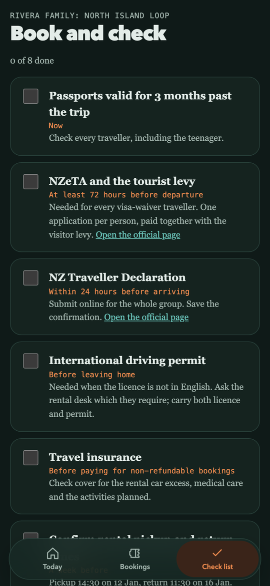

# Trip planner starter kit

Plan a family trip with Claude Code, then turn the plan into a private offline app (a PWA) and custom podcast episodes for the drives. This kit accompanies the Geocodio blog post [We Built Our Own Travel App, and It Came with a Podcast](https://www.geocod.io/code-and-coordinates/2026-11-02-we-built-our-own-travel-app-and-it-came-with-a-podcast/). It ships an example plan: a made-up family on five days in New Zealand's North Island.

<p align="center">
  
  
  
</p>

<p align="center"><em>The app the kit builds from the example trip: Today, Bookings, and the book-and-check list. It works offline once opened.</em></p>

## Quick start

1. Clone this repo and open the folder in [Claude Code](https://claude.com/claude-code).
2. Copy `.env.example` to `.env`, add your Geocodio API key (and an ElevenLabs key if you want podcast episodes), and load it: `set -a; source .env; set +a`.
3. Paste `prompts/01-kickoff.md` into Claude Code. It interviews you and replaces the example in `trip/` with your trip. Work through the other prompts in order.
4. Build the app: `python3 app/build.py`
5. Try it locally: `cd site && python3 -m http.server 8000`, then open http://localhost:8000 (on a phone, use your computer's address on the same Wi-Fi).
6. Deploy the `site/` folder to any static host: Netlify, Cloudflare Pages, GitHub Pages, Laravel Cloud, or your own server. Open the site once on each phone with a connection and add it to the home screen; after that it works offline.

You can look at the example first: it builds without any keys.

Needs Python 3 (standard library only) and, for audio, `ffmpeg`.

## Privacy

If `trip/trip.json` has booking details (references, hotel addresses, ticket times), host the site somewhere private or behind a password, and keep real trip data out of a public fork. The example data is made up. `site/`, `.env` and the podcast work files are git-ignored.

## Folder layout

```
CLAUDE.md          working rules Claude follows in this repo
prompts/           numbered starter prompts to paste into Claude Code
trip/
  family.md        who is coming, interests, energy, rules
  trip.json        the single source of truth (schema in trip/README.md)
tools/
  drive_times.py   geocodes places and measures drives with Geocodio
app/
  build.py         trip.json -> site/ (Today, Bookings, Check list)
  app.css app.js sw.js manifest.webmanifest icon.svg
  audio/           episode MP3s (created by the podcast pipeline)
podcast/           script -> two-voice MP3 pipeline (see podcast/GUIDE.md)
site/              the built app (git-ignored)
```

## Geocodio drive times

Drive times and distances in the app come from the [Geocodio](https://www.geocod.io) geocoding and distance APIs. Geocodio geocodes street addresses, so every place in `trip.json` stores one. After you add places or drives:

```
python3 tools/drive_times.py --dry-run   # see what would be requested
python3 tools/drive_times.py             # geocode places and measure drives, write results into trip.json
```

The example already includes its drive times, so it works out of the box.

## Make it yours

Edit `trip/trip.json` (or ask Claude to), then run `python3 app/build.py`.

- **Change the family profile.** Edit `trip/family.md`. Claude plans against it, so change names, ages, interests and rules first.
- **Add a day.** Append an object to `days` with a `date`, `title`, `summary` and `items`. Each item needs a `time`, `title` and a plain `what` line.
- **Add a drive.** Give a day a `drive` with `stops` (place keys, in order). Add any new places under `places` with street addresses, then run `python3 tools/drive_times.py`.
- **Add a checklist item.** Append `{"id": "ferry-tickets", "title": "Collect ferry tickets", "when": "1 hour before sailing", "notes": "Bring the booking email."}` to `checklist`. Checkboxes are saved on each phone.
- **Change colors.** Edit the variables at the top of `app/app.css` (`--accent`, `--teal`, `--paper`). Dark mode has its own set below them.
- **Add a podcast episode.** Follow `podcast/GUIDE.md`: pick voices once, then write `podcast/episodes/<slug>.txt` and run `./podcast/build.sh <slug> "Title"`. Add `"episode": {"file": "<slug>", ...}` to the drive and rebuild.

## License

MIT, copyright Geocodio.
